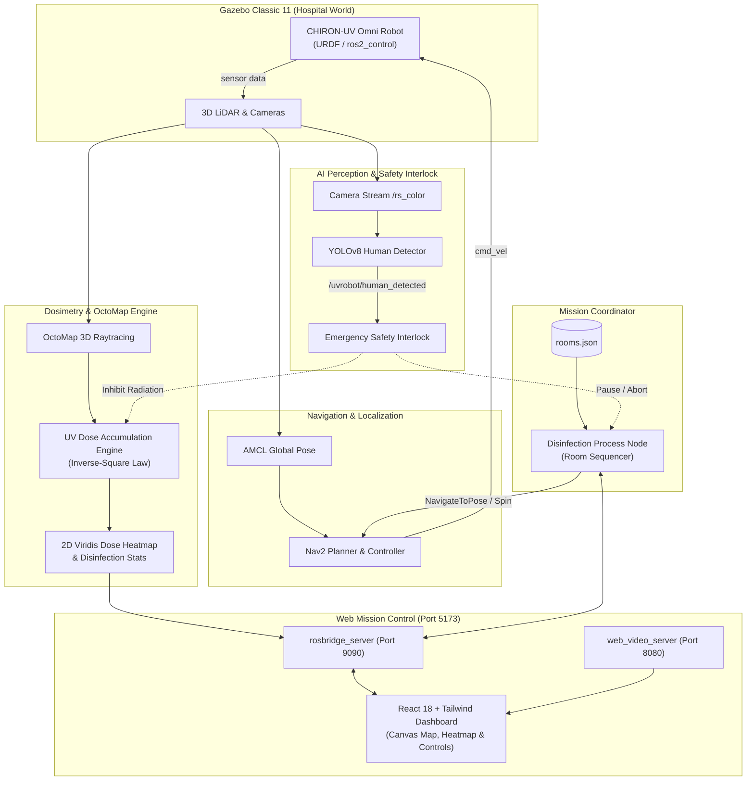

#  CHIRON-UV: Autonomous Hospital UV-C Disinfection Robot

[](https://docs.ros.org/en/humble/)
[](http://gazebosim.org/)
[](https://navigation.ros.org/)
[](https://github.com/ultralytics/ultralytics)
[](https://reactjs.org/)
[](LICENSE)

An end-to-end, production-grade autonomous UV-C disinfection robotics platform built with **ROS 2 Humble**, simulated in Gazebo Classic with the **AWS RoboMaker Hospital World**.

The system combines **3-wheel holonomic omnidirectional drive**, **3D volumetric LiDAR OctoMap raytracing**, **real-time UV dosimetry calculations (Inverse-Square Law)**, **Nav2 autonomous room coverage**, **YOLOv8 fail-safe human detection safety interlocks**, and an interactive **React 18 + Vite Mission Control Web Dashboard**.

<p align="center">
  
  
</p>

---

##  Table of Contents

- [Key Features](#-key-features)
- [System Architecture](#-system-architecture)
- [Robot Hardware & Kinematics](#-robot-hardware--kinematics)
- [Autonomous Navigation & SLAM](#-autonomous-navigation--slam)
- [Physics-Based UV Dosimetry Engine](#-physics-based-uv-dosimetry-engine)
- [Safety Interlocks & YOLOv8 Vision](#-safety-interlocks--yolov8-vision)
- [Mission Control Web Dashboard](#-mission-control-web-dashboard)
- [Repository Structure](#-repository-structure)
- [Prerequisites & Dependencies](#-prerequisites--dependencies)
- [Installation & Build](#-installation--build)
- [Quick Start Guide](#-quick-start-guide)
- [ROS 2 Interface (Topics & Services)](#-ros-2-interface-topics--services)
- [Troubleshooting](#-troubleshooting)
- [License](#-license)

---

##  Key Features

### 1.  Omnidirectional Mobile Platform & Actuation
- **Holonomic 3-Omniwheel Kiwi Drive** with custom URDF / Xacro kinematics, continuous velocity control via `ros2_control`, and custom odometry publisher.
- **Motorized UV-C Emitter Tube Arms**: Extendable position-controlled UV lamp actuators for targeted high-contact surface exposure.

<p align="center">
  
  
  
</p>

### 2.  Autonomous Nav2 Room Coverage
- Integrated **Navigation2 (Nav2)** with AMCL localization, global/local costmaps, and DWBP / Regulated Pure Pursuit controllers.
- **Automated Room Traversal Strategy**:
  $$\text{Door Waypoint} \longrightarrow \text{Corner 1} \longrightarrow \text{Corner 2} \longrightarrow \text{Corner 3} \longrightarrow \text{Corner 4} \longrightarrow \text{Center} \longrightarrow \text{360}^\circ \text{ Disinfection Spin}$$
- Automatic room selection and waypoint queueing via `config/rooms.json`.

<p align="center">
  
  
</p>

### 3. Physics-Based UV-C Dosimetry Engine
- Computes real-time irradiance and cumulative dose on 3D surfaces and 2D floor grids using the **Inverse-Square Law**:
  $$E = \min\left(\frac{P_{\text{UV}}}{4\pi (d^2 + r_0^2)}, E_{\max}\right), \quad D = \int E \, dt$$
- **OctoMap 3D PointCloud2 Surface Raytracing** and **2D Floor Heatmap Generation** utilizing a custom multi-stop Viridis color palette gradient to verify target sterilization thresholds ($J/m^2$ or $\mu W \cdot s / cm^2$).

<p align="center">
  
</p>

### 4.  YOLOv8 AI Human Detection & Fail-Safe Emergency Interlock
- High-frequency person detection pipeline running on robot camera feed (`/camera/image_raw` / `/rs_color/image_raw`).
- **Zero-Latency Emergency Shutoff**: Instantly terminates the UV dose server and halts autonomous navigation when any human enters the room, publishing alerts and bounding boxes.

<p align="center">
  
</p>

### 5.  Modern Mission Control Web Dashboard
- Built with **React 18**, **Vite**, **Tailwind CSS**, and **roslibjs** over a WebSocket bridge (`rosbridge_suite`).
- Features interactive hospital map telemetry, real-time robot pose tracking, live Viridis dose heatmap canvas overlay, MJPEG camera stream, mission progress tracking, room selection, manual teleop controls, and E-Stop.

<p align="center">
  
</p>

---

## System Architecture



---

##  Repository Structure

```
ros2_UV_disinfection_Robot_ws/
├── docs/
│   └── images/                         # Project diagrams, simulation captures, and dashboard UI screenshots
├── src/
│   ├── UV_disinfection_Robot/           # Core Robot Package
│   │   ├── CMakeLists.txt
│   │   ├── package.xml
│   │   ├── config/                      # Nav2 parameters, rooms.json, ros2_controllers
│   │   ├── launch/                      # Simulation, Nav2, Dosimetry, RViz launch files
│   │   ├── maps/                        # Hospital 2D occupancy grid maps & YAML configs
│   │   ├── meshes/                      # 3D STL meshes for omniwheels, chassis, and UV tubes
│   │   ├── models/                      # Gazebo models for AWS RoboMaker hospital environment
│   │   ├── rviz/                        # RViz display configurations
│   │   ├── scripts/                     # UV dosimetry, YOLO human detector, odometry & teleop
│   │   ├── urdf/                        # Robot description (Xacro macros, omniwheels, tube arms)
│   │   └── worlds/                      # Gazebo hospital world files
│   │
│   └── uv_web_dashboard/               # Web Mission Control Package
│       ├── setup.py
│       ├── package.xml
│       ├── launch/                      # UV_Dashboard.launch.py (Rosbridge + Web Server + Node)
│       ├── uv_web_dashboard/            # disinfection_process.py coordination node
│       └── web_frontend/                # React 18 + Vite + Tailwind CSS frontend source & dist
├── LICENSE                              # Apache-2.0 License
├── .gitignore                           # ROS 2 & Node workspace exclusions
└── README.md                            # Main project documentation
```

---

## Prerequisites & Dependencies

### System Requirements
- **OS**: Ubuntu 22.04 LTS (Jammy Jellyfish)
- **ROS 2**: Humble Hawksbill
- **Gazebo**: Gazebo Classic 11
- **Python**: 3.10+
- **Node.js**: v18+ (only needed if recompiling the web frontend; pre-built production assets are bundled)

### Install ROS 2 & System Packages

```bash
sudo apt update && sudo apt install -y \
  ros-humble-desktop \
  ros-humble-navigation2 \
  ros-humble-nav2-bringup \
  ros-humble-ros2-control \
  ros-humble-ros2-controllers \
  ros-humble-gazebo-ros2-control \
  ros-humble-rosbridge-suite \
  ros-humble-web-video-server \
  ros-humble-octomap \
  ros-humble-octomap-server \
  ros-humble-cv-bridge \
  python3-pip
```

### Install Python Dependencies

```bash
pip3 install ultralytics opencv-python numpy
```

---

## Installation & Build

1. **Clone the repository**:
   ```bash
   cd ~
   git clone https://github.com/aziziguidre/ros2_UV_disinfection_Robot_ws.git
   cd ros2_UV_disinfection_Robot_ws
   ```

2. **Install ROS workspace dependencies**:
   ```bash
   source /opt/ros/humble/setup.bash
   rosdep update
   rosdep install --from-paths src --ignore-src -r -y
   ```

3. **Build the packages**:
   ```bash
   colcon build --packages-select uv_disinfection_robot uv_web_dashboard --symlink-install
   source install/setup.bash
   ```

*(Optional: Build frontend from source)*
```bash
cd src/uv_web_dashboard/web_frontend
npm install
npm run build
cd ../../..
```

---

##  Quick Start Guide

Launch the full system using 4 terminal sessions:

### Terminal 1: Gazebo Hospital Simulation & Robot Spawn
```bash
source install/setup.bash
ros2 launch uv_disinfection_robot robot_gazebo.launch.py
```
> *Spawns the Chiron-UV omnidirectional robot in the AWS RoboMaker Hospital World, starts the joint state broadcaster, wheel controllers, and sensor pipelines.*

### Terminal 2: Nav2 Autonomous Navigation & AMCL
```bash
source install/setup.bash
ros2 launch uv_disinfection_robot robot_nav2.launch.py
```
> *Initializes AMCL localization against the pre-mapped hospital floor plan and brings up Nav2 path planning servers.*

### Terminal 3: UV Dosimetry & OctoMap Heatmap Engine
```bash
source install/setup.bash
ros2 launch uv_disinfection_robot disinfection.launch.py
```
> *Activates the OctoMap 3D raycaster and real-time UV dose accumulation engine.*

### Terminal 4: Mission Control Web Dashboard & Coordinator
```bash
source install/setup.bash
ros2 launch uv_web_dashboard UV_Dashboard.launch.py
```
> *Starts the Rosbridge WebSocket server (port 9090), Web Video Server (port 8080), the disinfection process node, and serves the dashboard on port 5173.*

### Access the Web Dashboard
Open your browser and navigate to:
 **`http://localhost:5173`**

---

##  ROS 2 Interface (Topics & Services)

### Key Published Topics
| Topic | Type | Description |
|---|---|---|
| `/uvrobot/disinfection_stats` | `std_msgs/String` | Real-time coverage percentage and accumulated dose stats. |
| `/uvrobot/dose_heatmap_2d` | `nav_msgs/OccupancyGrid` | 2D dose occupancy grid for RViz and web rendering. |
| `/uvrobot/dose_image` | `sensor_msgs/Image` | High-resolution RGBA Viridis heatmap image. |
| `/uvrobot/human_detected` | `std_msgs/Bool` | Safety flag indicating human presence in the zone. |
| `/uvrobot/human_count` | `std_msgs/Int32` | Number of detected persons. |
| `/uvrobot/yolo_image` | `sensor_msgs/Image` | Annotated camera feed with bounding boxes. |

### Key Services & Actions
| Name | Type | Description |
|---|---|---|
| `/start_disinfection` | `std_srvs/Trigger` | Starts OctoMap and UV dose computation stack. |
| `/stop_disinfection` | `std_srvs/Trigger` | Gracefully shuts down the dose accumulation engine. |
| `/navigate_to_pose` | `nav2_msgs/action/NavigateToPose` | Nav2 action for navigating between room waypoints. |

---

##  Useful Commands & Process Management

To kill all running simulation and navigation nodes cleanly:
```bash
pkill -9 -f gzserver; pkill -9 -f gzclient; pkill -9 -f robot_state_publisher
pkill -f odom.py; pkill -f slam_toolbox; pkill -f rviz2; pkill -f disinfection_process
```

To run manual keyboard teleoperation for the 3-omniwheel drive:
```bash
ros2 run uv_disinfection_robot teleop_keyboard_omni3.py
```

---

## 📜 License

This project is licensed under the **Apache License 2.0** — see the [LICENSE](LICENSE) file for details.
