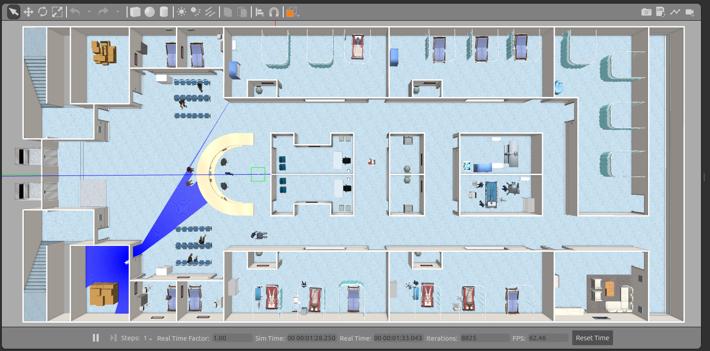
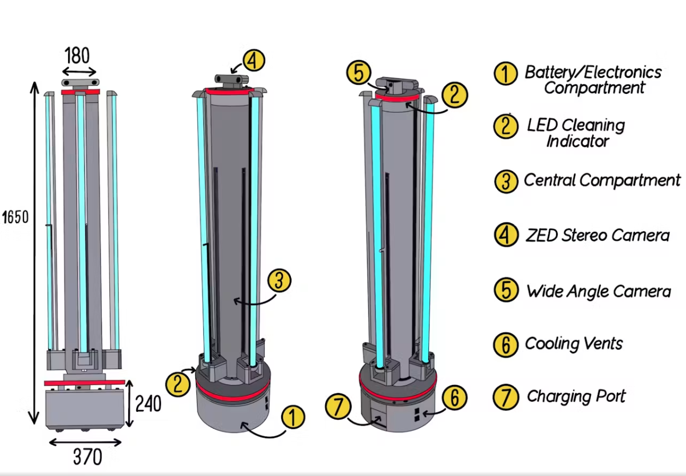
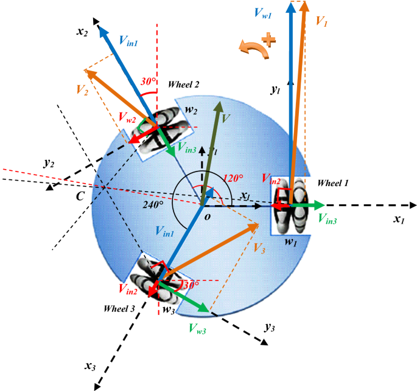
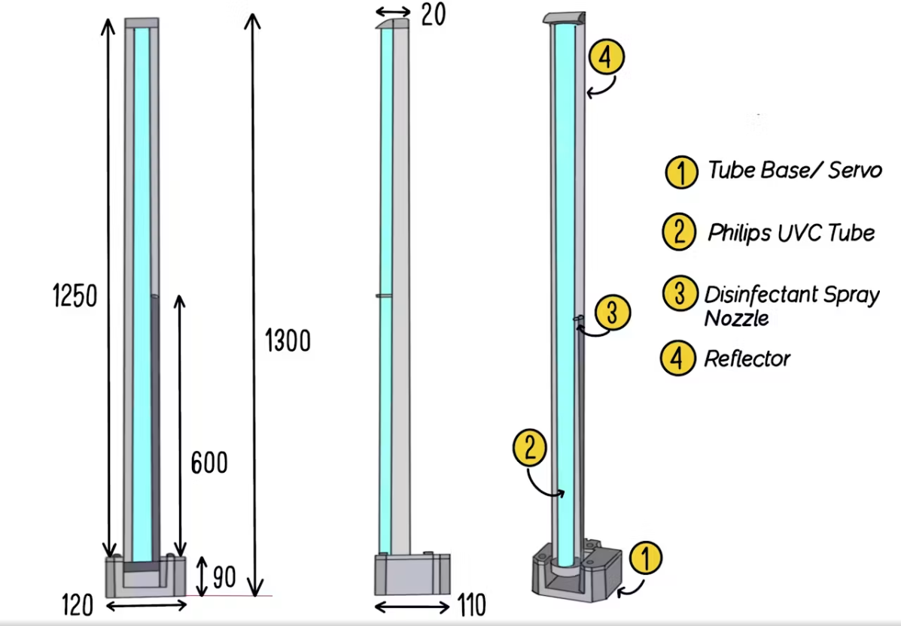
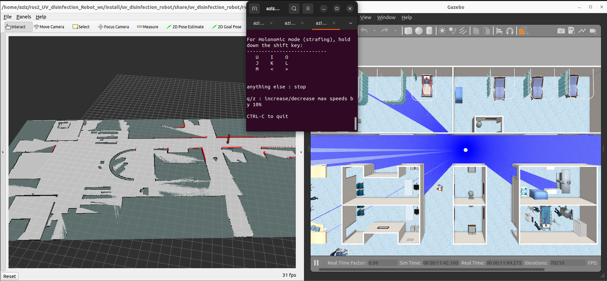
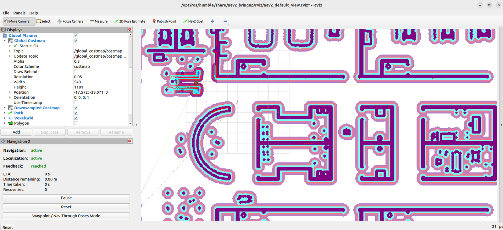
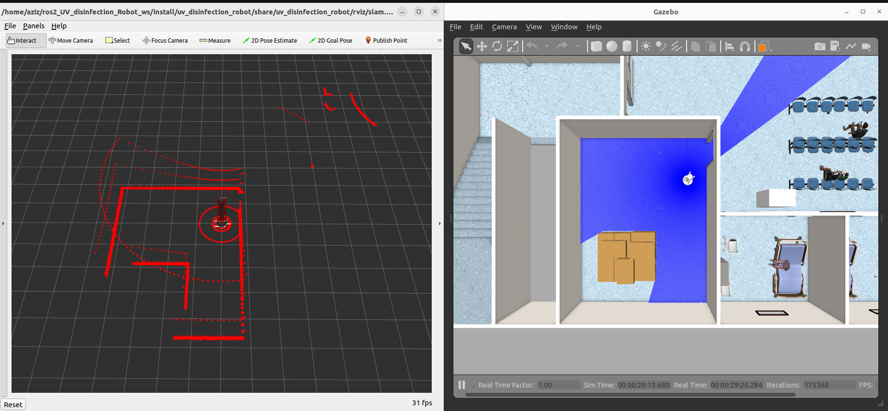
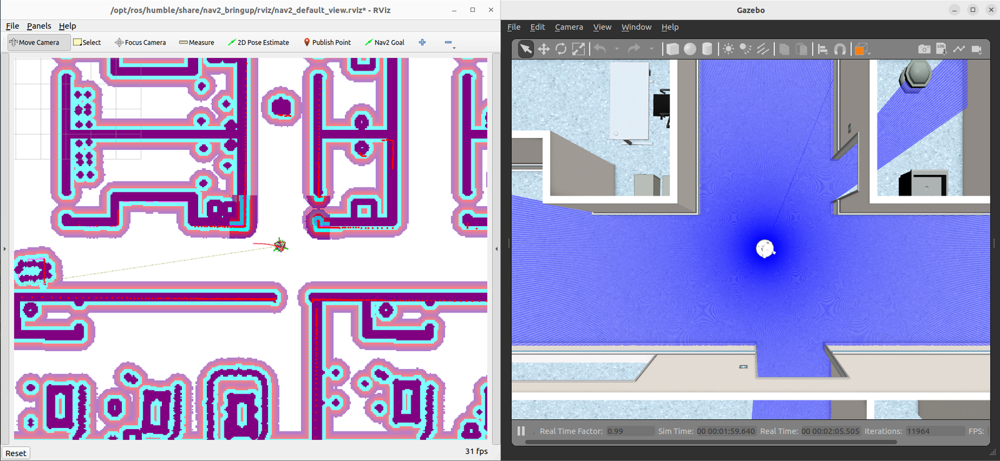
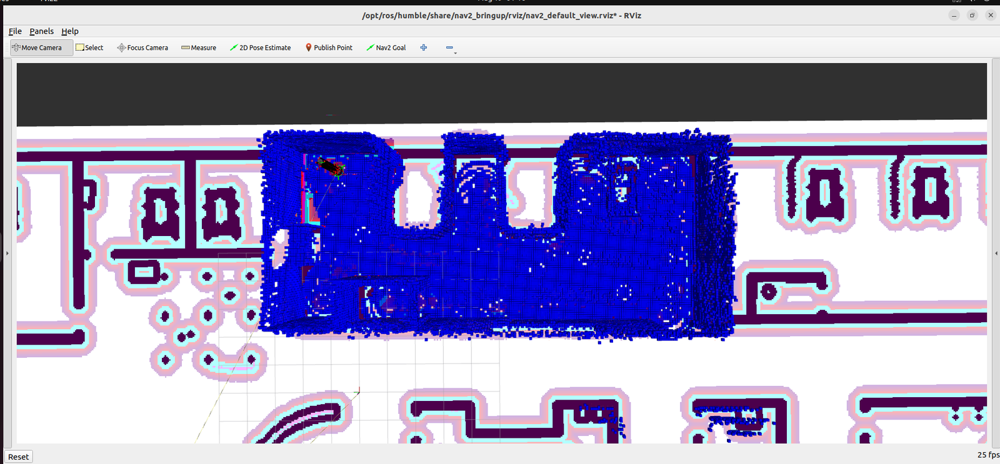
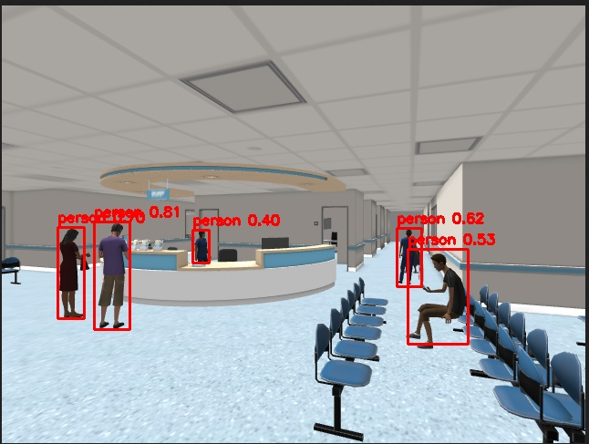

# 🤖 UV Disinfection Robot (`uv_disinfection_robot`)

[](https://docs.ros.org/en/humble/)
[](http://gazebosim.org/)
[](https://navigation.ros.org/)
[](https://github.com/ultralytics/ultralytics)

The core robotics package for the **CHIRON-UV** autonomous mobile disinfection platform. Contains the robot URDF/Xacro models, Gazebo Classic simulation environment, `ros2_control` velocity & position controllers, Navigation2 stack configuration, physics-based UV dosimetry raytracing engine, and YOLOv8 computer vision safety interlocks.

<p align="center">
  
</p>

---

## 📑 Table of Contents

- [Package Structure](#-package-structure)
- [Robot Kinematics & Actuation](#-robot-kinematics--actuation)
- [Autonomous Navigation (Nav2 & AMCL)](#-autonomous-navigation-nav2--amcl)
- [Physics-Based UV Dosimetry Engine](#-physics-based-uv-dosimetry-engine)
- [AI Safety Interlocks (YOLOv8 Vision)](#-ai-safety-interlocks-yolov8-vision)
- [Launch Files Reference](#-launch-files-reference)
- [Nodes & Scripts](#-nodes--scripts)
- [Topics, Services & Actions](#-topics-services--actions)
- [Build & Run](#-build--run)

---

## 📁 Package Structure

```
UV_disinfection_Robot/
├── CMakeLists.txt
├── package.xml
├── config/
│   ├── nav2_params.yaml          # Nav2 costmaps, DWBP controller & AMCL params
│   ├── rooms.json                # Hospital room coordinates, door waypoints & sweep corners
│   ├── ros2_controllers.yaml    # ros2_control velocity & position controller configs
│   └── slam.yaml                 # SLAM Toolbox online synchronous mapping params
├── launch/
│   ├── robot_gazebo.launch.py    # Gazebo hospital world, robot spawn, controllers & odom
│   ├── robot_nav2.launch.py      # Nav2 bringup, AMCL localization & lifecycle manager
│   ├── disinfection.launch.py    # OctoMap 3D raycaster & UV dose calculation engine
│   ├── robot_slam.launch.py      # SLAM Toolbox mapping launch
│   ├── robot_rviz.launch.py      # RViz2 visualization with robot model & sensors
│   └── dose_view.launch.py       # RViz2 preset for real-time UV dose heatmap viewing
├── maps/
│   ├── hospital_map.yaml / .pgm  # Pre-mapped 2D occupancy grid of AWS Hospital
│   └── map.yaml / .pgm           # High-resolution navigation map
├── meshes/                       # 3D STL meshes for base, omniwheels, rollers & UV lamps
├── models/                       # AWS RoboMaker hospital 3D models (beds, desks, walls, patients)
├── rviz/                         # RViz display configuration profiles (.rviz)
├── scripts/
│   ├── uv_irradiation_coverage.py# 3D OctoMap raytracing & 2D floor dose accumulation engine
│   ├── human_detector.py         # YOLOv8 human detection & emergency safety trigger
│   ├── odom.py                   # Custom omnidirectional odometry publisher
│   ├── cmd_vel_to_omni.py        # Twist to 3-wheel Kiwi drive velocity transformer
│   └── teleop_keyboard_omni3.py  # Interactive keyboard teleoperation for 3 omniwheels
├── urdf/
│   ├── main.urdf.xacro           # Complete robot model, sensors, and Gazebo plugins
│   ├── rim.urdf.xacro            # Omniwheel rim definition
│   ├── roller.urdf.xacro         # Passive roller sub-elements
│   ├── tube.urdf.xacro           # Motorized UV-C emitter tube arms
│   └── macros.xacro              # Inertia calculation macros
└── worlds/
    └── hospital.world            # AWS RoboMaker single-floor hospital world
```

---

## 🛞 Robot Kinematics & Actuation

The CHIRON-UV robot uses a **holonomic 3-wheel Kiwi omnidirectional drive** (wheels arranged at $120^\circ$ intervals), allowing it to translate in any direction without changing heading and spin concurrently. In addition, it features motorized position-controlled UV-C tube arm mechanisms that extend to optimize surface irradiation.

<p align="center">
  
  
  
</p>

### Kinematic Equations
Given linear velocities $(v_x, v_y)$ and angular velocity $\omega_z$:
$$\begin{bmatrix} v_1 \\ v_2 \\ v_3 \end{bmatrix} = \begin{bmatrix} -\sin(0) & \cos(0) & R \\ -\sin(120^\circ) & \cos(120^\circ) & R \\ -\sin(240^\circ) & \cos(240^\circ) & R \end{bmatrix} \begin{bmatrix} v_x \\ v_y \\ \omega_z \end{bmatrix}$$

- Controlled via `ros2_control` velocity controllers for each omniwheel.
- Linear actuators for the UV tubes controlled via position controllers.

---

## 🗺️ Autonomous Navigation (Nav2 & AMCL) & SLAM

CHIRON-UV integrates the ROS 2 Navigation2 stack configured for omnidirectional holonomic motion and SLAM Toolbox for online map building.

<p align="center">
  
  
</p>

<p align="center">
  
  
</p>

- **AMCL Localization**: Global adaptive Monte-Carlo localization utilizing 2D planar LiDAR scans mapped against the hospital floor plan.
- **Costmap Filters**: Global and local costmaps with inflation layers tuned for hospital corridor clearance.
- **Holonomic Path Execution**: DWB Controller (Dynamic Window Approach) configured to exploit omnidirectional degrees of freedom ($v_x, v_y, \omega_z$).

---

## ☀️ Physics-Based UV Dosimetry Engine

The `uv_irradiation_coverage.py` node computes real-time germicidal UV-C irradiation and cumulative dose across 3D surfaces and 2D floor areas.

<p align="center">
  
</p>

### Physical Model:
- **Inverse-Square Law**:
  $$E(d) = \min\left(\frac{P_{\text{UV}}}{4\pi (d^2 + r_0^2)}, E_{\max}\right)$$
- **Dose Accumulation**:
  $$D = \int_0^T E(d) \, dt \quad \left[\text{J/m}^2 \text{ or } \mu\text{W}\cdot\text{s/cm}^2\right]$$
- **3D Surface Raycasting**: Subscribes to `/octomap_point_cloud_centers` (`sensor_msgs/PointCloud2`) and calculates irradiance from 4 emitter tube centroids.
- **2D Floor Heatmap**: Projects radial rays at $2^\circ$ angular resolution up to 4.5 m, checking occupancy grid occlusions, and renders a 9-stop **Viridis color palette** to `/uvrobot/dose_heatmap_2d` and `/uvrobot/dose_image`.

---

## 👁️ AI Safety Interlocks (YOLOv8 Vision)

UV-C radiation (254 nm) breaks down organic DNA/RNA and causes photokeratitis and skin erythema. The `human_detector.py` node provides autonomous fail-safe safety.

<p align="center">
  
</p>

- **Model**: YOLOv8 Nano (`yolov8n.pt`) with Tensor/CUDA or CPU acceleration.
- **Inference**: Subscribes to camera topic (`/rs_color/image_raw` or `/camera/image_raw`), detecting COCO class 0 (Person).
- **Interlock Action**:
  - Immediately publishes `/uvrobot/human_detected = True`.
  - Inhibits the UV dose accumulation engine.
  - Signals the navigation coordinator to halt the robot until the zone is vacated.

---

## 🚀 Launch Files Reference

| Launch File | Description | Key Arguments |
|---|---|---|
| `robot_gazebo.launch.py` | Spawns CHIRON-UV in Gazebo AWS Hospital, brings up controllers and odom | `world`, `use_sim_time`, `samples` |
| `robot_nav2.launch.py` | Starts Nav2 stack, AMCL, and lifecycle manager | `use_sim_time`, `map`, `params_file` |
| `disinfection.launch.py` | Launches OctoMap server and `uv_irradiation_coverage.py` | `use_sim_time`, `voxel_size`, `target_dose` |
| `robot_slam.launch.py` | Launches SLAM Toolbox for online map generation | `use_sim_time` |
| `robot_rviz.launch.py` | Opens RViz2 with pre-configured robot and sensor displays | `use_sim_time` |
| `dose_view.launch.py` | Opens RViz2 configured specifically for real-time dose heatmap inspection | `use_sim_time` |

---

## 📡 Topics, Services & Actions

### Topics Published
- `/uvrobot/disinfection_stats` (`std_msgs/String`): Coverage %, elapsed time, accumulated dose.
- `/uvrobot/dose_heatmap_2d` (`nav_msgs/OccupancyGrid`): 2D Viridis dose occupancy grid.
- `/uvrobot/dose_image` (`sensor_msgs/Image`): High-resolution RGBA dosimetry heatmap.
- `/uvrobot/human_detected` (`std_msgs/Bool`): Fail-safe person detection flag.
- `/uvrobot/human_count` (`std_msgs/Int32`): Count of detected persons in the scene.
- `/uvrobot/yolo_image` (`sensor_msgs/Image`): Bounding-box annotated camera feed.

### Services & Actions
- `/start_disinfection` (`std_srvs/Trigger`): Starts OctoMap and UV dose computation engine.
- `/stop_disinfection` (`std_srvs/Trigger`): Cleanly terminates the dose server.
- `/navigate_to_pose` (`nav2_msgs/action/NavigateToPose`): Nav2 goal dispatch action.

---

## 🛠️ Build & Run

```bash
cd /home/aziz/ros2_UV_disinfection_Robot_ws
source /opt/ros/humble/setup.bash
colcon build --packages-select uv_disinfection_robot --symlink-install
source install/setup.bash

# Run Gazebo simulation
ros2 launch uv_disinfection_robot robot_gazebo.launch.py
```
