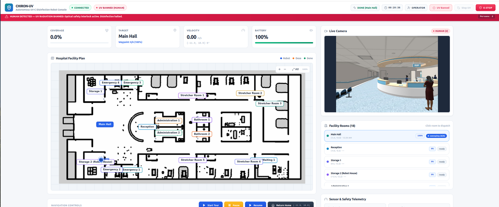

# 💻 UV Disinfection Robot — Web Dashboard & Mission Coordinator (`uv_web_dashboard`)

[](https://docs.ros.org/en/humble/)
[](https://reactjs.org/)
[](https://github.com/RobotWebTools/rosbridge_suite)
[](../../LICENSE)

The mission control and process coordination package for the **CHIRON-UV** disinfection robot. It integrates an interactive, modern **React 18 + Vite Web Dashboard** with a multi-threaded **ROS 2 Disinfection Process Coordinator node** (`disinfection_process.py`), communicating seamlessly via Rosbridge WebSockets and MJPEG video streaming.

<p align="center">
  
</p>

---

## 📑 Table of Contents

- [Package Structure](#-package-structure)
- [Key Features](#-key-features)
- [Mission Coordination Architecture](#-mission-coordination-architecture)
- [Safety Interlocks & HUD Alerts](#-safety-interlocks--hud-alerts)
- [Web Frontend Architecture](#-web-frontend-architecture)
- [ROS 2 Interface (Topics, Services, Actions)](#-ros-2-interface-topics-services-actions)
- [How to Build & Run](#-how-to-build--run)

---

## 📁 Package Structure

```
uv_web_dashboard/
├── CMakeLists.txt / setup.py
├── package.xml
├── launch/
│   └── UV_Dashboard.launch.py   # Unified launch: rosbridge, web video, static server, coordinator & detector
├── resource/
├── test/
├── uv_web_dashboard/
│   ├── __init__.py
│   └── disinfection_process.py  # ROS 2 multi-threaded room coverage state machine
└── web_frontend/                # React 18 + Vite + Tailwind CSS Source Code
    ├── dist/                    # Bundled production web assets (pre-built, zero-npm required)
    ├── public/                  # Hospital floor plan map.png, annotated rooms, favicons
    ├── src/
    │   ├── App.jsx              # Main telemetry HUD, canvas map renderer, dose overlay & controls
    │   ├── index.css            # Tailwind directives and custom UI styling
    │   └── main.jsx             # React DOM root entry point
    ├── index.html
    ├── package.json
    ├── tailwind.config.js
    └── vite.config.js
```

---

## 🌟 Key Features

1. **Interactive Hospital Map Canvas**: Renders the hospital floor plan with live robot pose ($x, y, \theta$), laser scans, active waypoints, and room boundaries.
2. **Real-Time UV Dosimetry Heatmap**: Overlays the accumulated UV-C irradiation heatmap dynamically across room floors.
3. **Automated Room Dispatcher**: Single-click selection for hospital rooms (Storage, Patient Rooms, ER) with automated door-entry and corner sweeping.
4. **Live Camera Feed with AI Overlay**: Embedded MJPEG camera stream showing real-time YOLOv8 person detection bounding boxes.
5. **Full Telemetry & Health Gauges**: Live reporting of battery status, current mission phase, waypoint index, target dose, and coverage percentage.
6. **Comprehensive Control Stack**: Start, Pause, Resume, Return to Home, Emergency Stop (E-Stop), and manual on-screen omnidirectional teleoperation.

<p align="center">
  
  
</p>

---

## 🤖 Mission Coordination Architecture (`disinfection_process.py`)

The coordinator node executes an autonomous coverage pattern for each targeted room defined in `config/rooms.json`:

$$\text{1. Doorway Approach} \longrightarrow \text{2. Corner 1} \longrightarrow \text{3. Corner 2} \longrightarrow \text{4. Corner 3} \longrightarrow \text{5. Corner 4} \longrightarrow \text{6. Center} \longrightarrow \text{7. 360}^\circ \text{ Spin}$$

### State Machine Lifecycle
- **`IDLE`**: Robot waits at charging station or home pose (`-11.88, 10.88`).
- **`TRANSIT`**: Nav2 navigates the robot through corridors to the room door waypoint.
- **`SWEEPING`**: Sweeps each corner sequentially, calculating UV-C dose accumulation.
- **`CENTER`**: Positions robot at the geometric center of the room.
- **`SPINNING`**: Performs a full $360^\circ$ rotation via Nav2 `Spin` action to eliminate blind spots and ensure maximum line-of-sight surface exposure.
- **`WAITING` / `COMPLETED`**: Disinfection stack is safely deactivated, ready for the next dispatch.

---

## 🛡️ Safety Interlocks & HUD Alerts

The node continuously monitors `/uvrobot/human_detected` from the YOLOv8 vision pipeline:
- **Instant Hold**: If a person enters during disinfection, navigation goals are immediately aborted, the mission generation counter is incremented, and `/disinfection/stop` is triggered.
- **Visual Alert**: The web dashboard displays an instant red banner notification: `SAFETY INTERLOCK: HUMAN DETECTED IN ZONE`.
- **Auto-Recovery**: Once the person exits the room, operator confirmation allows resumption from the pending waypoint.

---

## 🌐 Web Frontend Architecture

- **Framework**: React 18, Vite build tooling, Tailwind CSS.
- **ROS 2 Communication**: `roslibjs` managing asynchronous WebSocket channels to `rosbridge_server` on port `9090`.
- **Video Server**: `web_video_server` streaming ROS image topics as multipart MJPEG on port `8080`.
- **Canvas Rendering**: High-performance HTML5 2D Canvas performing real-time coordinate transformations between ROS map frames (`meters`) and pixel space (`543 × 1181`).
- **Zero-Setup Deployment**: Production build assets are pre-packaged in `web_frontend/dist/` and installed automatically with the package.

---

## 📡 ROS 2 Interface (Topics, Services, Actions)

### Subscriptions
- `/amcl_pose` (`geometry_msgs/PoseStamped`): Global robot localization.
- `/odom` (`nav_msgs/Odometry`): High-rate wheel odometry.
- `/uvrobot/human_detected` (`std_msgs/Bool`): Person detection safety signal.
- `/uvrobot/disinfection_stats` (`std_msgs/String`): Coverage % and accumulated dose stats.
- `/room/goal` (`std_msgs/String`): Target room dispatch command.
- `/room/command` (`std_msgs/String`): Navigation commands (`start`, `pause`, `resume`, `stop`, `home`).

### Services & Actions
- `/start_disinfection` (`std_srvs/Trigger`): Calls disinfection stack launcher.
- `/stop_disinfection` (`std_srvs/Trigger`): Gracefully shuts down dose calculation.
- `/navigate_to_pose` (`nav2_msgs/action/NavigateToPose`): Action client for Nav2 waypoints.
- `/spin` (`nav2_msgs/action/Spin`): Action client for $360^\circ$ disinfection rotations.

---

## 🛠️ How to Build & Run

### 1. Build Package
```bash
cd /home/aziz/ros2_UV_disinfection_Robot_ws
source /opt/ros/humble/setup.bash
colcon build --packages-select uv_web_dashboard --symlink-install
source install/setup.bash
```

### 2. Launch Dashboard System
```bash
ros2 launch uv_web_dashboard UV_Dashboard.launch.py
```

### 3. Open Web UI
Open any modern browser and navigate to:
👉 **`http://localhost:5173`**

*(Optional: Edit and recompile frontend)*
```bash
cd src/uv_web_dashboard/web_frontend
npm install
npm run build
```
